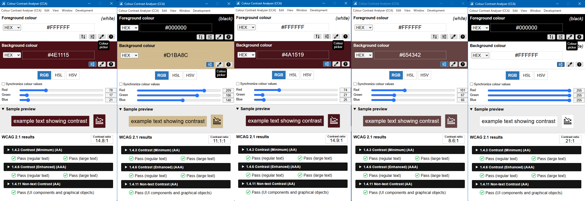

ENG 5311   
8 November 2026

## Team Ethics, Accessibility, and Risk Review

### Review Memo

### Accessibility Checklist
- Tag all text as either a H1, H2, or P
- Add alt text to header image
- Ensure color contrast with text
- Ensure text size contrast
- Set proper and logical reading order

### Identification of Possible User Harms or Exclusions

- **Color Contrast:** The color design primarily contains red and yellow. These colors are analogous. As such, the FAQ could be difficult to read for users who suffer from color blindness. 
- **Text Format:** In it's current state, the FAQ section, sidebar, and footnote bodies are in 12 point (11 for the footnote) Public Sans font. This font is rather thin and small, making it difficult to read for various audience members. 
- **Screen Reading:** The document, at the time of this submission, cannot be highlighted in its entirety. This makes it impossible for screen reading software to process and output a complete conversion of the document. This presents possible exclusion for audience members who are blind as well as those who have learning, cognitive, or motor disabilities. 

### Revision Plan 

To address the user harms or exclusions listed above, our group will perform the following two primary revisions: 

 1. **Use Open Broadcaster Software (OBS) to ensure screen readability**. After utilizing OBS, the team will conduct an internal test to guarantee the document was processed correctly.
 2. **Use Coolors to perform a color contrast check**. If the check determines the color design is acceptable, we will make no changes to the document. If the check determines the color design is not optimal, we will re-design the document according to the software's suggestions and our preferences to achieve a professional, polished product.

Additionally, we will continue formatting the document's text to find an appropriate font and font size that is readable. Likewise, our survey returned feedback that our original photo (included in the document's header) misrepresented the document's context. The feedback stated that the image containing people in a library setting mislead them to assume the content would relate solely to college students, whereas our document's content is more generalized. As such, we are seeking a more neutral header photo. These decisions are set to be made by next Sunday (November 17th, 2026), according to our group deadline. 

### List of Changes Made or Planned

#### Changes Made Based on Usability Survey:

- **Replaced FAQ Background Image:** Usability testing feedback indicated that the original background photo did not have a connection to technical communication. We replaced it with a relevant and licensed image from Texas State University’s Canto library to improve context.
- **Increased Footer Size:** Usability testing feedback indicated that the footer with white text against the maroon color was difficult to read. To remedy this, we have increased footer font size.

#### Changes Made for Accessibility:
The document, which was originally designed in Canva, has now been recreated in InDesign with the following revisions:

- **Typography and Readability Adjustments:** Based on our accessibility review, we will have increased the font size of the footer to improve readability.

- **Text:** All text has now been tagged as either a header or paragraph.

- **Color Contrast Corrections:** We have run the document through a color contrast checker and ensure the document meets standard accessibility contrast ratios.

  

- **Screen Reader Optimization:** We have restructured the file in InDesign to be fully compatible with screen readers by setting reading order

- **Alt text:** The top image has been given alt text so screen readers can narrate what the image presents. 
