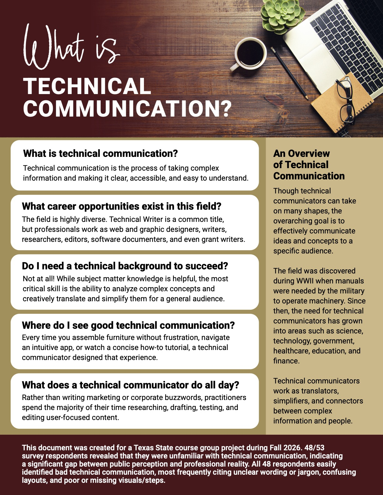

ENG 5311   
15 November 2026

## Team Final Revision and Portfolio Case Study Draft

### Project Context

### User Need

### Research Methods

We built a Qualtrics survey to establish a baseline understanding of technical communication. We utilized snowball sampling of individuals from our personal and professional circles to reach N=53 participants after 10 days, from 10/13/26 to 10/23/26. The responses helped validate the questions we chose for our FAQ pamphlet, as a plurality of respondents (34.1%) assumed technical communicators were programmers or IT specialists. We specifically designed our FAQ to highlight the field's versatility. While our data validates the core of our current FAQ, it also reveals specific areas where our document could be further expanded. 

Our survey consisted mostly of quantitative questions alongside a few qualitative ones, focusing on quantitative metrics to yield cleaner and clearer responses. We divided our survey using the initial quantitative question, “How familiar are you with the field of technical communication?” This triggered our branching logic and allowed us to curate the experience for both less experienced participants and seasoned professionals. This approach allowed us to keep all data consolidated in one spreadsheet while also avoiding survey fatigue.

### Design Decisions

We created a one page flyer to be as concise and as possible, with a clear layout that is quickly readable. This file format can be shared in a variety of ways (print, email, website). Since we are at Texas State University, we employed university brand colors (dark gold, bright gold, and maroon) and font (Roboto). We chose to make the “What is” text at the top stand out by using a handwriting font (Audrielle 2). This helps increase contrast and visually informs the document viewer that they are viewing an FAQ. We have kept the picture at the top generic to imply that technical communication isn’t only a Texas State University thing. Because the field of technical communication is so large and technical communicators take on a variety of duties, this generic photo also helps emphasize that the field is very broad and prevents us (the document creators) from creating any subconscious bias that tech comm is focused on only one thing.

### Testing Process

### Revisions

After feedback from usability test takers and our accessibility review, the following changes were made:
The following revisions were made for accessibility:

- **Switched software:** We recreated the document in Adobe InDesign from Canva to provide greater control over accessibility features.
- **Tagged text:** We applied heading and paragraph tags to help with screen-reader usability
- **Alt-text:** We added alternative text to the header image for accessibility.
- **Color contrast:** We tested five foreground and background color combinations and confirmed that each met WCAG 2.1 AAA text contrast requirements.

The following revisions were made from usability test feedback:
- **Text size:** After feedback from the usability test, we increased the footer font size to improve readability.
- **Relevant heading picture:** After feedback from the usability test, we replaced the original Texas State University library photograph of students studying with a more generally relevant image of a laptop to portray the field more accurately

### Final Deliverables

[Accessible PDF Version of What is Tech Comm FAQ](https://github.com/Shaneace89/ENG.5311-Project/blob/main/assets/what-is-tech-comm-faq.pdf)

  

### Description of Each Team Member’s Contributions

Umber

- Assisted with content inventory of existing resources about technical communication
- Developed style sheet
- Created the design of the final deliverable
- Ensured final deliverable is accessible
- Outlined ethics of qualtrics survey
- Assisted with Qualtrics survey questions
- Helped disseminate Qualtrics survey and gather respondents
- Created usability test

### Remaining Revision Checklist
