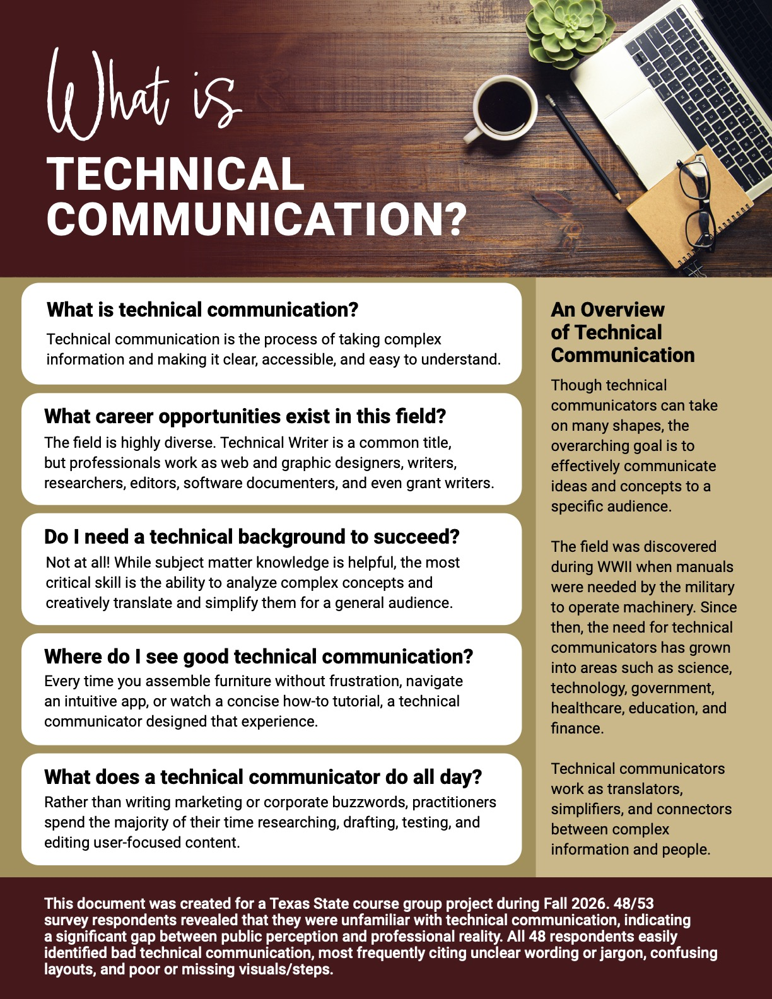

ENG 5311   
15 November 2026

## Team Final Revision and Portfolio Case Study Draft

### Project Context

Our project is a Frequently Asked Questions (FAQ) document titled _What is Technical Communication?_ and, as the title suggests, the document aims to be an informative resource answering common misconceptions about and offering relevant insight into the academic and career field of technical communication. This project came from the team's personal experience as students and professionals of technical communication in which friends, family members, peers, and even the occasional co-worker did not understand the roles and responsibilities nor the knowledge and skill sets of technical communicators. In other words, every member of the team had a similar experience of explaining _who_ they were as technical communicators and _what_ they do; as well as diligently acknowledging that this explanation could be starkly different depending on the technical communicator due to the field's versatility. This universal experience was the core identifier for the problem the team wanted to approach: What can we create to bridge this gap of information for a wide audience? After a lengthy analysis and development stage, we decided that a FAQ fitting a single, easily printable and shareable page would be the perfect medium. Instead of assuming the frequently asked questions of our intended users, we developed and conducted our own survey amongst 53 participants to accurately discern what were the gaps in knowledge for non-professionals participants and where there were opportunities to provide a more in-depth overview according to professional participants. Following the survey, we were able to create a document that provides the following information: a definition of technical communication, career opportunities, experience requirements, examples of technical communication in everyday life, and the general (but less known) tasks of technical communicators. Additionally, we include a sidebar that contains a brief history and overview of technical communication and a footnote that classifies the FAQ as an academic team project and notates the Qualtrics survey methodology. This combination of document components results in an FAQ that can be distributed to a multitude of audiences with an assortment of needs!

### User Need

The FAQ is intended to be accessible and usable to a wide audience, including experts and non-experts. For example, faculty (i.e. experts) for a college English department, technical communication program, or technical communication course  may share the FAQ via e-mail, handout, or bulletin board in an attempt to inform students (i.e. non-experts) of the field and influence them to consider investing their education in it. Another hypothetical scenario that was prevalent during the projects' development was that of a business owner (i.e. non-expert) who is considering hiring a technical communicator but is unsure if such an employee is necessary or beneficial; perhaps, in this scenario, a fellow business owner or employee (i.e. possible expert or non-expert) provides the FAQ to assist in the business owner's decision making. While there are many  possible users and situations, there is one core *need* at the center of them all: a quick, reliable resource that explains what technical communication is and what technical communicators generally do.    

### Research Methods

We built a Qualtrics survey to establish a baseline understanding of technical communication. We utilized snowball sampling of individuals from our personal and professional circles to reach N=53 participants after 10 days, from 10/13/26 to 10/23/26. The responses helped validate the questions we chose for our FAQ pamphlet, as a plurality of respondents (34.1%) assumed technical communicators were programmers or IT specialists. We specifically designed our FAQ to highlight the field's versatility. While our data validates the core of our current FAQ, it also reveals specific areas where our document could be further expanded. 

Our survey consisted mostly of quantitative questions alongside a few qualitative ones, focusing on quantitative metrics to yield cleaner and clearer responses. We divided our survey using the initial quantitative question, “How familiar are you with the field of technical communication?” This triggered our branching logic and allowed us to curate the experience for both less experienced participants and seasoned professionals. This approach allowed us to keep all data consolidated in one spreadsheet while also avoiding survey fatigue.

### Design Decisions

We created a one page flyer to be as concise and as possible, with a clear layout that is quickly readable. This file format can be shared in a variety of ways (print, email, website). Since we are at Texas State University, we employed university brand colors (dark gold, bright gold, and maroon) and font (Roboto). We chose to make the “What is” text at the top stand out by using a handwriting font (Audrielle 2). This helps increase contrast and visually informs the document viewer that they are viewing an FAQ. We have kept the picture at the top generic to imply that technical communication isn’t only a Texas State University thing. Because the field of technical communication is so large and technical communicators take on a variety of duties, this generic photo also helps emphasize that the field is very broad and prevents us (the document creators) from creating any subconscious bias that tech comm is focused on only one thing.

### Testing Process

The team conducted two evaluations: a Qualtrics survey (October 13–23, 2026) and a usability test (October 16–17, 2026). Both collected quantitative and qualitative feedback to assess audience understanding and document effectiveness.

#### Objectives and Participants

The **Qualtrics survey** assessed familiarity with technical communication and collected 53 responses, including 44 completed questionnaires, through snowball sampling. The **usability test** evaluated the FAQ's clarity, readability, organization, and design with five participants (ages 25–48) who had limited to no prior knowledge of the field.

#### Methods and Procedures

**Qualtrics Survey**
1. Distributed the survey through personal and professional networks.
2. Used branching logic to tailor questions to participants' familiarity levels.
3. Collected and compiled responses for analysis.

**Usability Test**
1. Distributed the digital FAQ through Canva.
2. Asked participants to evaluate content, grammar, design, navigation, and comprehension.
3. Collected feedback through a five-question Google Forms questionnaire measuring perceived learning, clarity, confusion, and suggested improvements.

#### Evaluation and Revision

The team analyzed numerical responses and written feedback, using a five-point clarity scale for the usability test (1 = "Very clear"; 5 = "Not clear at all"). Results were documented through tables, charts, and participant comments. Identified issues were prioritized according to their effects on comprehension, readability, and editorial accuracy to guide final revisions.

### Revisions

After feedback from usability test takers and our accessibility review, the following changes were made:
The following revisions were made for accessibility:

- **Switched software:** We recreated the document in Adobe InDesign from Canva to provide greater control over accessibility features.
- **Tagged text:** We applied heading and paragraph tags to help with screen-reader usability
- **Alt-text:** We added alternative text to the header image for accessibility.
- **Color contrast:** We tested five foreground and background color combinations and confirmed that each met WCAG 2.1 AAA text contrast requirements.

The following revisions were made from usability test feedback:
- **Text size:** After feedback from the usability test, we increased the footer font size to improve readability.
- **Relevant heading picture:** After feedback from the usability test, we replaced the original Texas State University library photograph of students studying with a more generally relevant image of a laptop to portray the field more accurately

### Final Deliverables

[Accessible PDF Version of What is Tech Comm FAQ](../assets/what-is-tech-comm-accessible.pdf)

  

### Description of Each Team Member’s Contributions

Umber

- Assisted with content inventory of existing resources about technical communication
- Developed style sheet
- Created the design of the final deliverable
- Ensured final deliverable is accessible
- Outlined ethics of Qualtrics survey
- Assisted with Qualtrics survey questions
- Helped disseminate Qualtrics survey and gather respondents
- Created usability test in Google Forms

Morgan

- Assisted with Qualtrics survey questions
- Helped disseminate Qualtrics survey and gather respondents
- Gathered similar document references for development and design
- Contributed to weekly written reports (i.e. assignments) detailing the development, design, and re-design process 
- Reviewed, edited, and revised weekly assignments and document updates
- Analyzed and revised the document's purpose, medium, and audience in early development stages 
- Assisted with (and justified via assignments) the layout and design of the doucment
- Attended weekly meetings to discuss the short and long term goals of the project and delegate responsibilities to team members  

Sam

- **Research:** Gathered information about technical communication and identified common misunderstandings about the field.
- **FAQ Content:** Researched and wrote questions and answers to make sure the information was accurate, clear, and useful to our audience.
- **Qualtrics Survey:** Helped develop questions for the survey, reviewed responses, and used the findings to help determine what information to include in the flyer.
- **Ethics, Accessibility, and Risk Memo:** Wrote the memo outlining ethical concerns, accessibility needs, and potential risks related to the project.
- **Usability Testing:** Helped conduct the usability test, reviewed participant feedback, and summarized the findings to identify areas for improvement.
- **Team Report:** Wrote the executive summary and next steps, highlighting the team's work, key findings, and recommended actions.

Shane

- Developed survey in Qualtrics
- Parsed through all 50+ survey respondent input and summarized main findings, and pulled respondent quotes
- Drafted language of Q and A section of deliverable
- Helps disseminate Qualtrics survey and usability test
- Provided extensive guidance on GitHub formatting
- Contributed to weekly written reports (i.e. assignments) detailing the development, design, and re-design process
- Attended weekly meetings to discuss the short and long term goals of the project and delegate responsibilities to team members  

### Remaining Revision Checklist

No revisions remain on the flyer. The final, accessible version was completed after the usability and accessibility reviews.
