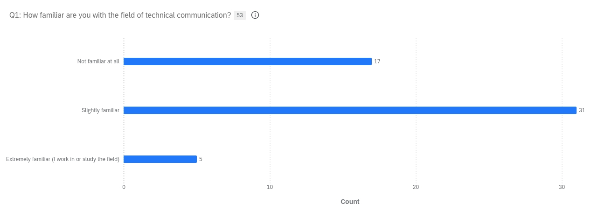
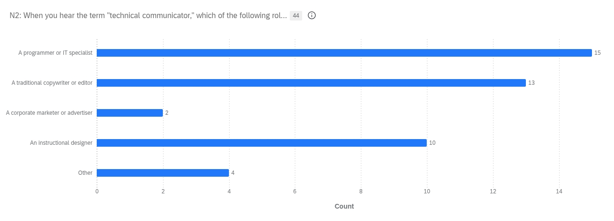
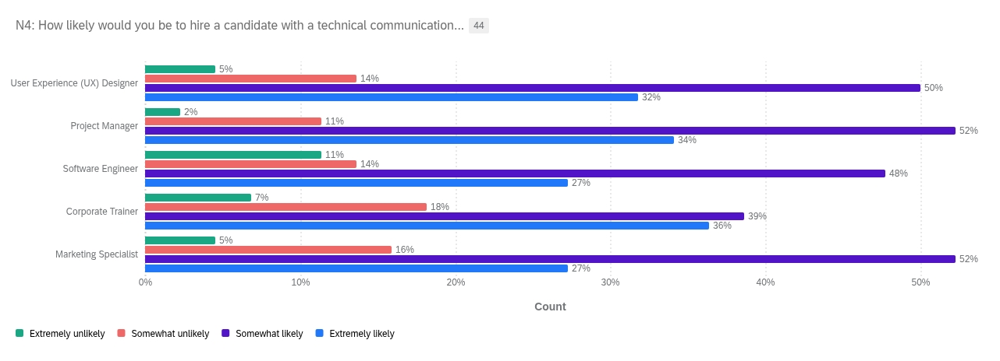

ENG 5311   
1 November 2026

## Team Report

### Executive Summary/Overview

### Project Status

### Rationale 

As students and practitioners of technical communication we are aware that the average person (i.e. our families, friends, and sometimes professional or academic peers) is not well-informed on what technical communication is academically or professionally. This FAQ is designed to provide insight into common misconceptions or gaps in knowledge concerning the roles, responsibilities, and duties of technical communicators in their profession. The FAQ is the chosen medium due to its inherent requirement to perform research that can determine what *do* people know and what they do *not*. Through this required research, we intend to narrow down which aspects of technical communication are eluding outsiders of the field and, with that insight, we can develop the document to be a clear, concise resource that replaces those deficits of knowing with a foundational understanding. We acknowledged quickly that a standalone FAQ could risk missing some of the brief histories of technical communication and simpler definitions of *who* technical communicators are and *what* they do--for that reason we added a sidebar which includes this information, which we deem necessary to the goal of crafting a foundational resource. The ultimate benefit of this document, both in its design and content, is its ability to be distributed amongst and utilized by expert and non-expert audiences; with this document's purpose, use, and benefit to non-experts being covered above. Experts can add the FAQ to their repertoire of as an educational tool, an informative handout, or as a possible recommendation sheet for those who they deem could benefit from employing a technical communicator or could succeed at becoming a technical communicator. Altogether, at its core, this FAQ is an informative resource. 

### Recommendations 

*1. Linguistic accessability* 

   In its current form this document is only available in English. However, there is the possibility of being utilized by Texas State University's Master's of Art in Technical Communication (MATC) program. "Hispanic enrollment at Texas State has increased over 30% in the past decade, well above the growth rate of Hispanics at all Texas public universities. The University has been designated an Hispanic-Serving Institution by the U.S. Department of Education and the Hispanic Association of Colleges and Universities." (Texas State University, 2026). Considering this, it could be ethically considerate and appropriate to develop a Spanish version of the document to accommodate the present Hispanic community. This accommodation also increases the document's (and therefore the MATC program's) outreach. 

*2. Visitor count and time on page* 

   The document can be distributed as printable or shareable PDF. If it is utilized in an e-format it would be optimal to include a visitor counter and time on page coding metrics. Visitor counts, as the name suggest, counts the number of visitors to webpage. The time on page metric calculates the total duration a user spends viewing a specific webpage before navigating away or exiting. Such data could showcase if users are utilizing the resource, how many users are utilizing the resource (in total, at certain times, etc.), the average time users spend with the resource (presumably reading it), and if users are reading the document (based on times spent on the webpage). 

*3. Helpfulness rating QR code*

  It is important to the creators of this document to know if it succeeds at the goal it was designed for. However, the creators are considered experts themselves, and therefore cannot have the experience of a non-expert when reviewing the document. Further feedback from non-expert users would be necessary to determine if the document is helpful to that audience. Adding a QR code that is linked to a small survey could provide the creators with an avenue to obtain this feedback. This feedback would be utilized for future revisions. 
  
### Findings from our survey

We hosted a survey for 10 days, from 10/13/26 to 10/23/26, and invited individuals from our personal and professional circles to share their experience with technical communication. If they felt obliged, we encouraged them to share the survey to help cause a snowball effect. We received a total of N=53 survey responses, with n=44 fully completed results. Most of these results were centralized in the greater Austin area (n=26), with a few outreaches extending as far as Northern Virginia. Our respondents ranged from 'Extremely Familiar' (n=5) and 'Slightly Familiar' (n=31) with the field, to 'Not Familiar at all' (n=17). This wide range of participants gave us great insight into preconceived notions and misunderstandings, as well as a few insider trade secrets. 

  

The newcomers, those who were 'Slightly Familiar' or 'Not Familiar at all' (n=44), assumed the term "technical communicator" was primarily associated with the following roles: 'A Programmer or IT Specialist' (n=15), a 'Traditional Copywriter or Editor' (n=13), and an 'Instructional Designer' (n=10). 

  

We also surveyed these newcomers (n=44) regarding which positions they would be most likely to hire a candidate with a technical communications background for. When looking at the highest enthusiasm 'Extremely likely', we found they were most likely to hire them for 'Corporate Trainer' (n=16) and 'Project Manager' (n=15) positions, with 'UX Designer' (n=14), 'Marketing Specialist' (n=12), and 'Software Engineer' (n=12) following closely behind.

  

These early findings validated the questions we chose for our FAQ pamphlet, because the majority of our audience assumed technical communicators were IT specialists or software engineers. We specifically designed our FAQ to highlight the field's versatility. While our data validates the core of our current FAQ, it also reveals specific areas where our document could be further expanded.

### Next steps

### References 

Texas State University. (2026, May). _Texas State University: Texas State Profile_. https://www.txst.edu/about/profile.html
