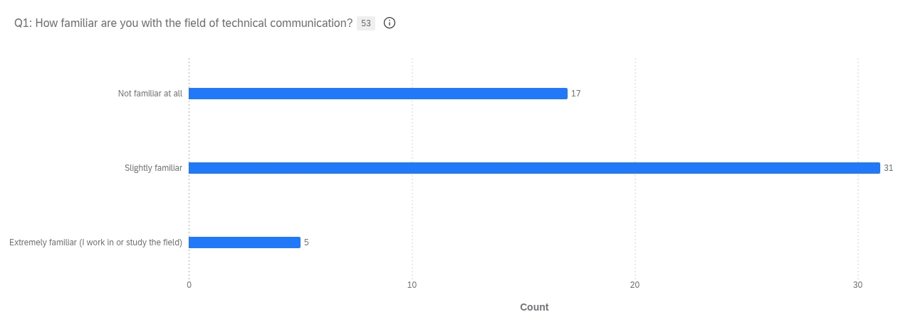
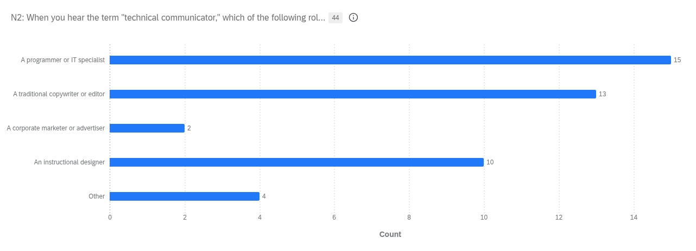
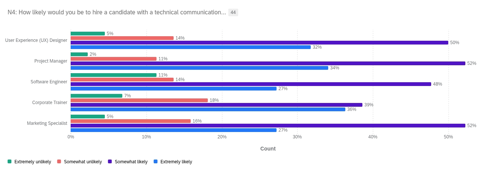

ENG 5311   
1 November 2026

## Team Report

### Executive Summary/Overview

### Project Status

### Recommendation

### Rationale

### Findings from our survey

We hosted a survey for 10 days, from 10/13/26 to 10/23/26, and invited individuals from our personal and professional circles to share their experience with technical communication. If they felt obliged, we encouraged them to share the survey to help cause a snowball effect. We received a total of N=53 survey responses, with n=44 fully completed results. Most of these results were centralized in the greater Austin area (n=26), with a few outreaches extending as far as Northern Virginia. Our respondents ranged from 'Extremely Familiar' (n=5) and 'Slightly Familiar' (n=31) with the field, to 'Not Familiar at all' (n=17). This wide range of participants gave us great insight into preconceived notions and misunderstandings, as well as a few insider trade secrets. 

  

The newcomers, those who were 'Slightly Familiar' or 'Not Familiar at all' (n=44), assumed the term "technical communicator" was primarily associated with the following roles: 'A Programmer or IT Specialist' (n=15), a 'Traditional Copywriter or Editor' (n=13), and an 'Instructional Designer' (n=10). 

  

We also surveyed these newcomers (n=44) regarding which positions they would be most likely to hire a candidate with a technical communications background for. When looking at the highest enthusiasm 'Extremely likely', we found they were most likely to hire them for 'Corporate Trainer' (n=16) and 'Project Manager' (n=15) positions, with 'UX Designer' (n=14), 'Marketing Specialist' (n=12), and 'Software Engineer' (n=12) following closely behind.

  

These early findings validated the questions we chose for our FAQ pamphlet, because the majority of our audience assumed technical communicators were IT specialists or software engineers. We specifically designed our FAQ to highlight the field's versatility. While our data validates the core of our current FAQ, it also reveals specific areas where our document could be further expanded.

### Next steps
