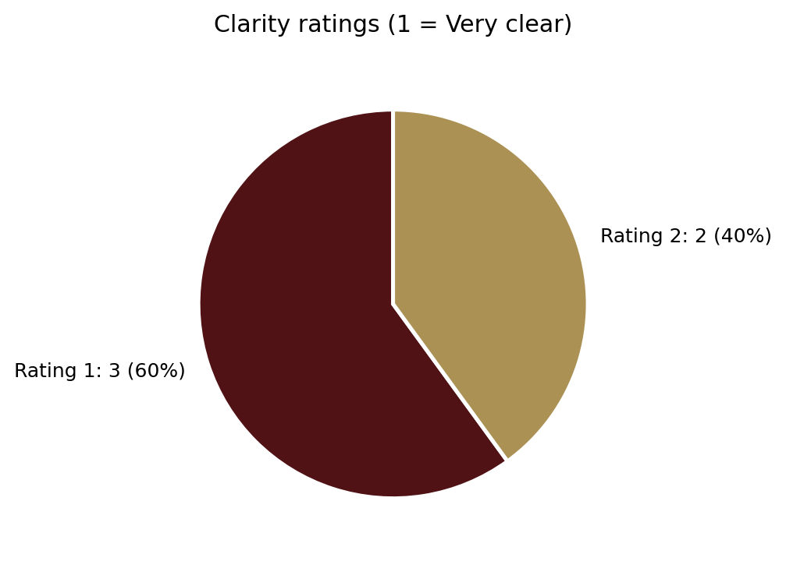
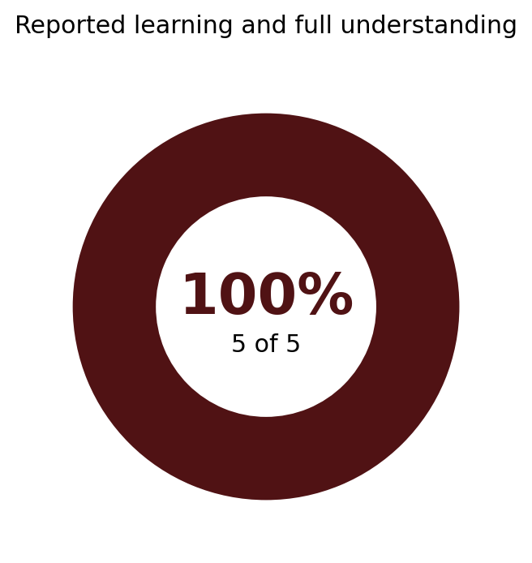

ENG 5311   
18 October 2026 

## Usability Test and Report

### Usability Test Plan

**User Information**

You will be taking part in a usability test featuring an FAQ document. During this test you will analyze the document for its content and design. When you are done with your analysis of the document, you will complete a brief feedback form detailing what you learned, what about the document is effective and what could be improved. 

Thank you for your time, feedback, and support! 

**User Instructions** 

The following instructions have been provided to guide our users through the testing process: 

1. Read through the [FAQ](https://canva.link/no9hfbzyr6swur8) in its entirety.
2. Analyze the FAQ for its content, grammar, design, and overall cohesion. 
3. Consider these three questions: Do you understand the document--not only what it says, but what it is intended to do? Was it easy navigating the document? If required, would you be able to explain to another person how this document could be applied in a real-world scenario? 
4. Annotate as needed! Feel free to make notes on your version of the FAQ for us to review. 
5. Provide feedback through the given [Google form](https://forms.gle/Q47rbMeKSAoTYTGi8).

### Usability Post-Test Questions
1. Tell us about yourself. What is your age, and what do you do? *Example response: (29, I work in retail)*
2. After reading the document, how much new information did you learn?
3. If any, which part(s) of the document made the information confusing?
4. How clear was the document?
5. What else can help make the document be clear? Type N/A if nothing.

### Test Report

| Tell us about yourself. What is your age, and what do you do? | After reading the document, how much new information did you learn? | If any, which part(s) of the document made the information confusing? | How clear was the document? *1 = Very clear, 5 = Not clear at all*| What else can help make the document be clear? Type N/A if nothing. |
| :--- | :--- | :--- | :--- | :--- |
| 36, Research Analyst at Texas State University | I learned about technical communication and understood the document fully. | Nothing was confusing, n/a | 1 | I think the document does a great job of explaining what technical communication is and the idea behind who is considered a technical communicator. The only thing I saw that might need to be updated is in the caveat at the bottom. I would make the second sentence past tense (that they were unfamiliar) but it reads really well regardless of if you change that or not. Nice job! |
| 48, software dev | I learned about technical communication and understood the document fully. | Nothing was confusing, n/a | 2 | The layout is easy to follow, and the bold questions make it easy to find information quickly. I liked the everyday examples, especially the furniture instructions and how-to tutorials. One small suggestion would be to make the footer text a little larger so it’s easier to read. |
| 36, Business Manager  | I learned about technical communication and understood the document fully. | Nothing was confusing, n/a | 2 | In the instructions - the word (document) is misspelled. Nothing, I think the document is clear in the information you are attempting to convey. Document is legible, spaced correctly, answers the question with conveying positive attribute to the field.   |
| 28; Supply Specialist | I learned about technical communication and understood the document fully. | Nothing was confusing, n/a | 1 | I didn’t understand how the picture related to technical communication. When I first saw the picture next to the title I thought I was going to learn about how technology or software is used in school to communicate. Liked the document though. |
| 25, work in fulfillment operations | I learned about technical communication and understood the document fully. | Nothing was confusing, n/a | 1 | N/A |

### Summary of Findings

All five participants reported learning about technical communication and understanding the FAQ. The review took place October 16–17, 2026, with adults ages 25–48 working in research, software development, business management, supply operations, and fulfillment operations.

Every participant selected the response indicating they learned about technical communication and understood the document fully. All five also selected “Nothing was confusing.” These are self-reported impressions, not scores from a comprehension or task-performance test.

  

*Figure 1. Self-reported learning and understanding, n = 5.*

Clarity ratings were favorable: three participants rated the document **1 (Very clear)** and two rated it **2** on the stated scale of 1 (Very clear) to 5 (Not clear at all). The average was **1.4**. The graph below follows the ratings in the Test Report table above.

  

*Figure 2. Document clarity ratings, n = 5; lower scores indicate greater clarity.*

The written responses explain what worked. One participant found the bold questions easy to scan and praised familiar examples such as furniture instructions and how-to tutorials. Another described the document as legible and correctly spaced. These comments support keeping the question-and-answer layout and concrete examples.

Participants also pointed to changes worth making. One person initially understood the title image to be about software used in schools rather than technical communication. Another asked for larger footer text. Two participants suggested editing the caveat's tense and checking a reported spelling error in the instructions. No one reported failing to understand the document overall, but these comments show where presentation and editing can improve.

### Revision List

The priorities below reflect how each issue could affect a reader's first impression, ability to read the page, or confidence in the writing. Each issue was mentioned by one participant.

| Priority | Proposed change | Basis in the review |
| --- | --- | --- |
| High | Replace or remove the title image so it more clearly represents technical communication. | P4 initially expected a discussion of technology or software used in schools. |
| Medium | Increase the footer font size and check its legibility in the printed flyer format. | P2 requested larger footer text. |
| Low | Review the second sentence of the caveat and adjust the tense if the passage calls for it. | P1 suggested past tense. |
| Low | Check the instructions for the reported misspelling of “document,” correct it if present, and proofread the final copy. | P3 reported a spelling error. |

The image is the first change to make because it affected the subject a reader expected to encounter. The footer adjustment is localized but may help with readability. The editorial issues should be checked before publication; the comment about the spelling error does not establish whether it appears in the FAQ itself or in the testing instructions.

Keep the bold questions, everyday examples, and overall spacing. Participants specifically praised these features, and the responses provide no basis for a broader redesign.

### Evidence Supporting Major Recommendations

Four participants provided specific suggestions in the open-ended question. Their original comments appear in the Test Report table; the excerpts below connect those responses to the proposed changes.

| Participant | Evidence from the open-ended response | Revision supported |
| --- | --- | --- |
| P4 | “I didn’t understand how the picture related to technical communication.” | Reconsider the title image. |
| P2 | “One small suggestion would be to make the footer text a little larger so it’s easier to read.” | Enlarge the footer text. |
| P1 | “I would make the second sentence past tense (that they were unfamiliar)” | Review the caveat's verb tense. |
| P3 | “In the instructions - the word (document) is misspelled.” | Verify and correct the reported typo. |

P4's longer response explains the reasoning behind the highest-priority revision: the image prompted an expectation about school software rather than the topic explained in the FAQ. P2's comment points to a specific readability adjustment, not a problem with the whole layout. P1 and P3 raised smaller editorial issues that can be resolved in a final copyedit.

The feedback also supports choices to retain. P2 wrote, “The layout is easy to follow, and the bold questions make it easy to find information quickly,” and liked the furniture-instruction and how-to-tutorial examples. Those details are more useful for the next draft than a generic claim that participants liked the FAQ.

### Limits of the Review and Next Steps

The team collected five post-reading questionnaires but did not document timed navigation tasks, direct observations, or a scored comprehension exercise in the supplied record. These findings therefore describe participants' reported experiences, not verified task success or knowledge retention. The small, varied group also does not establish how all prospective MATC students would respond.

Before producing the final flyer, the team should review the title image, increase footer legibility, verify the two editing suggestions, and retain the formats and examples participants found useful. A brief review of the revised flyer would help confirm whether the image now conveys the intended subject.

### GitHub link to the relevant file, folder, or repository location

**GitHub Repository**   
[https://github.com/Shaneace89/ENG.5311-Project](https://github.com/Shaneace89/ENG.5311-Project)

**GitHub Usability Test Draft**   
[https://github.com/Shaneace89/ENG.5311-Project/blob/main/assets/what-is-tech-comm.pdf](https://github.com/Shaneace89/ENG.5311-Project/blob/main/assets/what-is-tech-comm.pdf)
